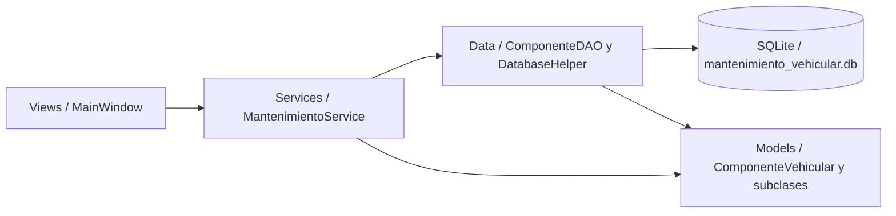
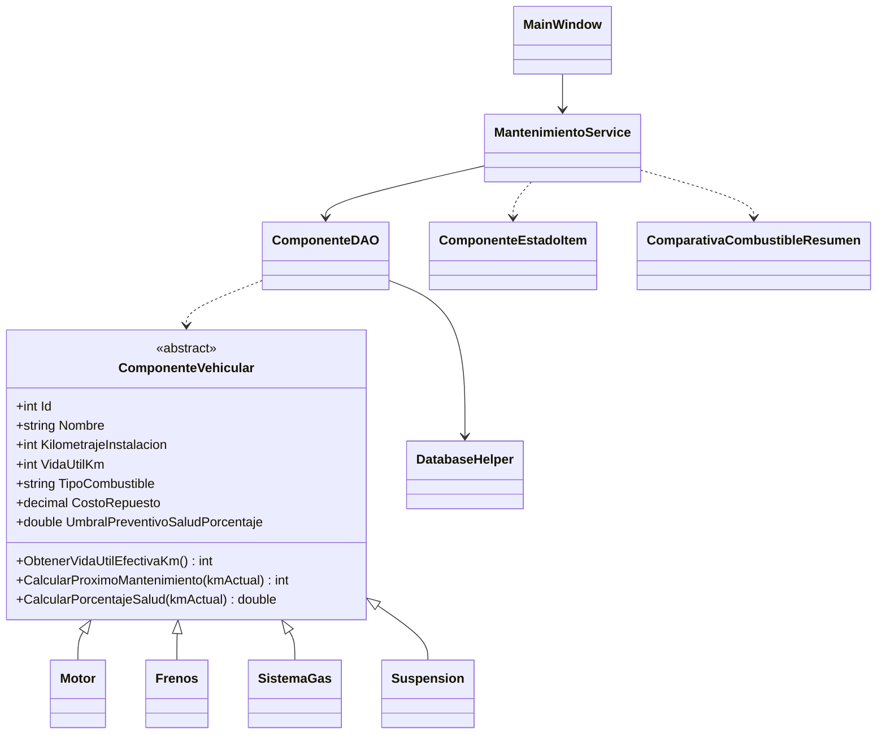

<div align="center">
  <h1>Gestor de Mantenimiento Vehicular</h1>
  <p>Aplicación de escritorio para administrar componentes, mantenimiento preventivo y costos de combustible.</p>
  <p>
    
    
    
    
  </p>
</div>

## 6.1. Descripción y tecnologías

El proyecto registra y consulta componentes vehiculares, estima su salud según el kilometraje, emite alertas preventivas y compara el costo estimado de recorrer una distancia con gasolina o GNV.

| Tecnología | Implementación |
|---|---|
| Plataforma | .NET 8 (`net8.0`) |
| Lenguaje | C# |
| Interfaz | Avalonia UI 11.3.22 |
| Persistencia | SQLite mediante `Microsoft.Data.Sqlite` 8.0.33 y ADO.NET, sin ORM |

## 6.2. Arquitectura por capas

```text
Views (MainWindow) ➔ Services (MantenimientoService) ➔ Data (ComponenteDAO / DatabaseHelper) ➔ SQLite (mantenimiento_vehicular.db)
```

Todas las capas trabajan sobre el mismo dominio definido en `Models/`: `MantenimientoService` calcula y valida con esas entidades, y `ComponenteDAO` las reconstruye al leer filas de SQLite. `Views/MainWindow` consume los estados y resúmenes que el servicio deriva de esas entidades.



## 6.3. Diseño POO: encapsulamiento y validación

`ComponenteVehicular` es abstracta. Encapsula los datos mediante campos privados y propiedades validadas:

| Propiedad | Regla aplicada |
|---|---|
| `Id` | No puede ser negativo; `0` representa un elemento aún no insertado. |
| `Nombre` | Obligatorio, no puede ser blanco y se almacena sin espacios al inicio o al final. |
| `KilometrajeInstalacion` | Debe ser mayor o igual a `0`. |
| `VidaUtilKm` | Debe ser mayor que `0`. |
| `TipoCombustible` | Solo acepta `Gasolina` o `GNV`; normaliza el valor. |
| `CostoRepuesto` | Debe ser mayor o igual a `0`; se redondea a dos decimales. |

La clase calcula vida efectiva, kilometraje objetivo, desgaste, salud y alerta preventiva. La alerta se activa cuando la salud es menor o igual al umbral de la subclase.
En el servicio, el nombre además debe tener al menos dos caracteres y `SistemaGas` debe estar asociado exclusivamente a `GNV`.

## 6.4. Herencia y polimorfismo

Las subclases sobrescriben (`override`) el umbral de salud y el cálculo de vida útil efectiva según el componente:

| Subclase | Regla polimórfica | Umbral preventivo |
|---|---|---:|
| `Motor` | En operación con GNV aplica un factor térmico `0.90` a la vida útil nominal; con gasolina conserva el valor nominal. | `20%` de salud |
| `Frenos` | Aplica el margen de seguridad crítica `0.85` a la vida útil nominal. | `30%` de salud |
| `SistemaGas` | En operación con GNV limita la vida efectiva al menor valor entre la vida nominal y el intervalo máximo de `20,000 km`. | `25%` de salud |
| `Suspension` | Aplica el factor de desgaste vial `0.95` a la vida útil nominal. | `25%` de salud |

Además, el servicio valida que `SistemaGas` opere exclusivamente con `GNV`; intentar registrarlo con `Gasolina` produce un error de validación.

### Diagrama UML de clases



## 6.5. Comparativa Gasolina vs. GNV

La comparación es paramétrica y se calcula a partir de las constantes de `ComponenteVehicular`:

| Combustible | Rendimiento promedio | Precio de referencia | Costo estimado por km |
|---|---:|---:|---:|
| Gasolina | `40 km/galón` | `$15,800 COP/galón` | `$395 COP/km` |
| GNV | `14 km/m³` | `$2,900 COP/m³` | Aproximadamente `$207.14 COP/km` |

`MantenimientoService.CalcularResumenYComparativa` usa `1,000 km` por defecto. Con estos valores estima `$395,000 COP` para gasolina y aproximadamente `$207,142.86 COP` para GNV; el ahorro se redondea a dos decimales y el porcentaje se calcula respecto al costo de gasolina.

## 6.6. Persistencia relacional: SQLite + ADO.NET

Al crear `DatabaseHelper`, este genera automáticamente `mantenimiento_vehicular.db` en `AppContext.BaseDirectory` (junto al ejecutable), abre la base con modo `ReadWriteCreate` y ejecuta `CREATE TABLE IF NOT EXISTS`.

| Tabla | Esquema |
|---|---|
| `Componentes` | `Id INTEGER PRIMARY KEY AUTOINCREMENT`; `TipoComponente TEXT NOT NULL`; `Nombre TEXT NOT NULL`; `KilometrajeInstalacion INTEGER NOT NULL CHECK (KilometrajeInstalacion >= 0)`; `VidaUtilKm INTEGER NOT NULL CHECK (VidaUtilKm > 0)`; `TipoCombustible TEXT NOT NULL`; `CostoRepuesto REAL NOT NULL CHECK (CostoRepuesto >= 0)`; `FechaRegistro TEXT NOT NULL DEFAULT (datetime('now', 'localtime'))`. |
| `ConfiguracionVehiculo` | `Clave TEXT PRIMARY KEY`; `Valor TEXT NOT NULL`. Se inserta por defecto `KilometrajeActual = 0` con `INSERT OR IGNORE`. |

El acceso se implementa exclusivamente con `Microsoft.Data.Sqlite` (`SqliteConnection`, `SqliteCommand`, `SqliteDataReader`); no se usa Entity Framework ni otro ORM. Las entradas SQL se envían mediante parámetros, por ejemplo `cmd.Parameters.AddWithValue(...)`, y conexiones, comandos y lectores se liberan con bloques `using`.

`ComponenteDAO` implementa inserción, consulta, actualización, eliminación y persistencia del odómetro. Al consultar, `MapearComponente(SqliteDataReader)` usa `TipoComponente` para reconstruir el tipo concreto (`Motor`, `Frenos`, `SistemaGas` o `Suspension`).

## 6.7. Instalación y ejecución

```bash
git clone https://github.com/sebas269/GestorMantenimientoVehicular
cd GestorMantenimientoVehicular
dotnet restore
dotnet build
dotnet run
```

## 6.8. Guía de pruebas funcionales

En los formularios de alta se deben completar los campos obligatorios con valores válidos, salvo en los casos de validación negativa.

| Caso | Acción y datos de prueba | Resultado esperado |
|---|---|---|
| P1 | Aplicar odómetro actual `42000 km` y consultar el resumen. | El odómetro queda guardado y se recalculan estados, salud y próximos mantenimientos. |
| P2 | Registrar tipo `Motor`, nombre `Kit Distribución`, odómetro de referencia `42000 km`; completar vida útil y costo con valores válidos. | Mensaje de éxito, nuevo Id y componente visible en la bitácora. |
| P3 | Registrar tipo `Frenos`, nombre `Pastillas Delanteras`; completar los demás campos con valores válidos. | Mensaje de éxito y elemento visible con su salud calculada. |
| P4 | Registrar tipo `SistemaGas`, nombre `Inyectores GNV`, combustible `GNV`; completar los demás campos con valores válidos. | Registro aceptado y vida efectiva limitada al intervalo máximo de `20,000 km` cuando corresponda. |
| P5 | Intentar registrar tipo `SistemaGas` con combustible `Gasolina`. | Se rechaza la operación y el banner informa que el sistema de gas opera exclusivamente con GNV. |
| P6 | Seleccionar un elemento existente, modificar sus datos y ejecutar `Actualizar`. | Mensaje de actualización y lista/resumen recalculados con los cambios. |
| P7 | Seleccionar un elemento existente y ejecutar `Eliminar`. | Mensaje de eliminación; el elemento desaparece de la lista actualizada. |
| P8 | En `Km Instalación`, ingresar `abc` e intentar guardar. | El parseo se rechaza, el banner informa que se requiere un entero válido y la aplicación permanece abierta. |

## 6.9. Evidencias y problemas encontrados

### Evidencias de funcionamiento

Las capturas son evidencia visual de los estados indicados; no sustituyen por sí solas una inspección directa de SQLite.

| Prueba | Estado según las capturas recibidas |
|---|---|
| Registro y consulta | Respaldados por la confirmación de los registros Id 9 e Id 10 y la lista visible. |
| Actualización | Pendiente: no se recibió captura que muestre un mensaje de actualización. |
| Eliminación | Respaldada parcialmente: la captura muestra `Componente #8 eliminado de la bitácora`, pero el recorte no incluye la lista posterior para verificar la ausencia. |
| Validación | Respaldada visualmente por el error de costo no numérico con la interfaz aún visible. |
| Persistencia tras reinicio | Pendiente: no se recibió una captura tomada después de cerrar y volver a abrir la aplicación. |


Esta captura muestra un estado vencido en rojo y componentes óptimos; no muestra una alerta ámbar.


#### Evidencia adicional de eliminación


### Problemas encontrados y soluciones

1. **Reconstrucción polimórfica desde `SqliteDataReader`:** leer una fila como la clase abstracta no permite conservar el comportamiento de cada componente. `ComponenteDAO.MapearComponente` inspecciona `TipoComponente` y crea la subclase concreta usando el constructor que recibe también el Id. Un tipo desconocido produce `InvalidOperationException`.
2. **Parseo y errores de entrada:** se validan odómetro, kilometraje de instalación y vida útil con `int.TryParse`, y el costo con `decimal.TryParse` usando cultura invariante. Los eventos capturan la excepción de validación y la muestran en el banner, sin cerrar la ventana.
3. **Refresco de la `ProgressBar` en Avalonia:** el servicio vuelve a calcular `PorcentajeSalud` al cargar los componentes. La vista enlaza el valor de la barra a esa propiedad y reasigna la lista (`ItemsSource`) tras aplicar el odómetro y después de operaciones CRUD, provocando la actualización de estado y salud mostrados.
